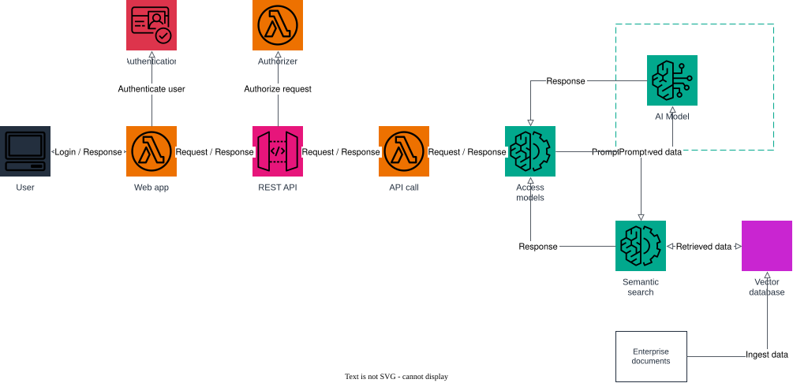

# AWS Project: Serverless Semantic Search Assistant

This architecture creates a serverless digital assistant for domain-specific questions, using
Retrieval Augmented Generation (RAG) over an enterprise data source.

1. a user signs in to the Assistant UI (`web-app` Lambda) through Cognito authentication;
2. the web app calls the REST API (API Gateway), guarded by a Cognito authorizer;
3. API Gateway invokes the `api-call` Lambda, which forwards the prompt to the `access-models` Lambda;
4. `access-models` runs a semantic search against the vector database (an OpenSearch Serverless
   collection behind a Bedrock knowledge base) to retrieve the most relevant enterprise document
   chunks;
5. it then sends the prompt plus the retrieved data to the AI model (Amazon Bedrock) and returns
   the generated, grounded answer back through the chain to the user.

Enterprise documents uploaded to S3 are ingested into the vector database so they can be searched
semantically.

## Prerequisites

- Docker
- Terraform 1.5+
- AWS CLI

## Start Floci

```bash
docker compose up -d
```

## Apply Terraform

```bash
terraform init
terraform apply
```

## Architecture



The diagram source is a real, editable [draw.io](https://www.drawio.com/) file at
[docs/architecture.drawio](docs/architecture.drawio), generated programmatically with the
[drawpyo](https://github.com/MerrimanInd/drawpyo) Python library. Open the `.drawio` file directly
on GitHub or with the draw.io desktop app / [app.diagrams.net](https://app.diagrams.net/) to edit it.

To regenerate the diagram (`.drawio` source + the `.svg`/`.png` embedded above) after changing the
architecture:

```bash
python3 -m venv .diagram-venv
.diagram-venv/bin/pip install drawpyo
.diagram-venv/bin/python scripts/generate_diagram.py

# rasterize the .drawio file to svg/png (used by the README) via headless draw.io
docker run --rm -v "$PWD/docs":/data -w /data rlespinasse/drawio-export -f svg -o . --output-mode relative --remove-page-suffix .
docker run --rm -v "$PWD/docs":/data -w /data rlespinasse/drawio-export -f png -o . --output-mode relative --remove-page-suffix -t .
```

## Load enterprise documents into the vector database

Upload a few company documents, then trigger ingestion so the knowledge base can search them:

```bash
DOC_BUCKET=$(terraform output -raw enterprise_documents_bucket)
KB_ID=$(terraform output -raw knowledge_base_id)

aws --endpoint-url http://localhost:4566 s3 cp ./policy.txt "s3://$DOC_BUCKET/policy.txt"

aws --endpoint-url http://localhost:4566 bedrock-agent start-ingestion-job \
  --knowledge-base-id "$KB_ID" --data-source-id "$(terraform output -raw enterprise_documents_bucket)"
```

## Sign in and ask the assistant

Create and confirm a Cognito user, then authenticate to get an ID token:

```bash
export USER_POOL_ID=$(terraform output -raw cognito_user_pool_id)
export CLIENT_ID=$(terraform output -raw cognito_client_id)

aws --endpoint-url http://localhost:4566 cognito-idp sign-up \
  --client-id "$CLIENT_ID" --username jane --password 'Passw0rd!'

aws --endpoint-url http://localhost:4566 cognito-idp admin-confirm-sign-up \
  --user-pool-id "$USER_POOL_ID" --username jane

TOKEN=$(aws --endpoint-url http://localhost:4566 cognito-idp initiate-auth \
  --client-id "$CLIENT_ID" --auth-flow USER_PASSWORD_AUTH \
  --auth-parameters USERNAME=jane,PASSWORD='Passw0rd!' \
  --query 'AuthenticationResult.IdToken' --output text)
```

Call the REST API directly:

```bash
API_URL=$(terraform output -raw api_endpoint)

curl -s -X POST "$API_URL/search" \
  -H "Authorization: Bearer $TOKEN" \
  -H "Content-Type: application/json" \
  -d '{"prompt": "What is our data retention policy?"}' | jq
```

Or open the web app and paste the token into the "Cognito ID token" field:

```bash
open "$(terraform output -raw web_app_url)"
```

If you want to follow the execution, watch the Floci container logs:

```bash
docker compose logs -f floci
```

## Clean up

```bash
terraform destroy
docker compose down
```
